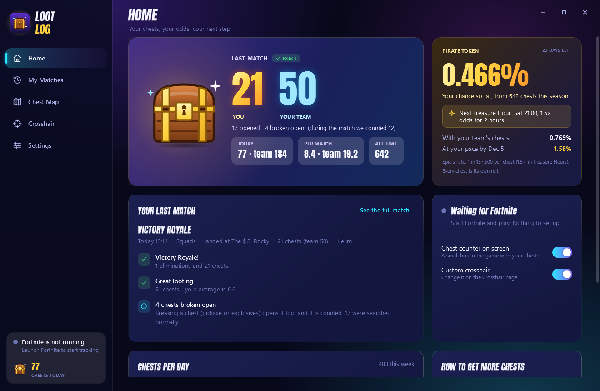

# LootLog: chest tracker for Fortnite

LootLog is a free Windows app that counts every chest you open in Fortnite and shows your real odds of finding the Pirate Shop token.



## What it does

- **Exact chest count after every match.** When you leave a match, LootLog reads the replay that Fortnite saves. The replay records who opened each chest, so the count includes chests you broke with the pickaxe, and ammo boxes are left out.
- **You and your team.** It counts your chests and your squad's, and keeps chests per match (CPM) for you and for the team.
- **Pirate token odds.** Your chance of having found the Pirate Shop Access token so far, at Epic's rate of 1 in 137,500 per chest. Chests opened during Treasure Hours count 1.5×.
- **On-screen counter.** A small box in the game shows chests this match, today, all time, per match and your odds.
- **Chest map.** Chest spots learned from your replays, and the drops where you open the most chests per match.
- **Match reports.** Your route on the map with every chest and fight, a timeline with the loot from each chest, and tips: hot drops, time to your first chest, storm time, and how you were eliminated.
- **Custom crosshair**, shown only while Fortnite is in front.

## Get it

**[⬇ Download LootLog-win-Setup.exe](https://github.com/moyutry/LootLog/releases/latest/download/LootLog-win-Setup.exe)** (Windows 10/11, 64-bit)

1. Run `LootLog-win-Setup.exe`. It installs in one click, with no admin rights needed, and opens LootLog. Windows may say "Windows protected your PC" because the app isn't code-signed yet. Click **More info → Run anyway**.
2. A short setup walks you through it: your chest key, replays, the Fortnite window mode, and the on-screen box.
3. Play. Your chests appear when you're back in the lobby.

LootLog **updates itself**. New versions download in the background and install when Fortnite is closed, never during a match. Prefer no installer? Get `LootLog-win-Portable.zip` from [Releases](https://github.com/moyutry/LootLog/releases/latest).

In Fortnite, keep **Settings → Game → Replays → Record Replays** on, and use **Windowed Fullscreen** (Settings → Display → Window Mode) so the on-screen box shows.
## Safe by design

- It never reads or writes the game's memory or files. It only reads `FortniteGame.log` and the `.replay` files Fortnite saves itself, after the match.
- Key presses are only listened to (Raw Input). Nothing is blocked, delayed or sent.
- The overlays are separate click-through windows, like Discord's or OBS's.
- Text reading (for the live counter) runs on your PC with Windows' own OCR. Nothing is uploaded. The only network call downloads the island map from fortnite-api.com.

## FAQ

**Why is the live number sometimes different from the final one?** During the match LootLog sees a chest when you press your chest key and the "Search" prompt disappears. Fortnite shows the same prompt for ammo boxes, and broken chests show none. So the live number is an estimate. It learns what chests look like on your screen from your replays and improves every match. The number after the match is exact.

**No number after a match?** Replays are probably off in Fortnite. Turn on Record Replays.

**Do streamers see the box on stream?** Only if you want: turn on "I stream or record" in the setup, or "Hide my overlays from recordings" off in Settings.

**Is this from Epic?** No. LootLog is a fan-made tool and is not affiliated with or endorsed by Epic Games. Fortnite is a trademark of Epic Games, Inc.

---

## For developers

C# / WPF on .NET 10.

```powershell
powershell -ExecutionPolicy Bypass -File install.ps1             # build, pack the installer (Velopack), install here
powershell -ExecutionPolicy Bypass -File install.ps1 -NoInstall  # build + pack only (dist\releases)
powershell -ExecutionPolicy Bypass -File install.ps1 -Publish    # ...and upload to GitHub Releases (feeds auto-update)
dotnet test tests/FortniteHelper.Tests
```

`LootLog.exe --snap <folder>` renders every page to PNGs in headless mode: no overlays, no input hooks, and no single-instance lock. Set `LOOTLOG_DATA_DIR` to a copy of the data folder.

```
src/FortniteHelper.Core          Pure logic: log parser, match/storm tracker, replay header parser, chest prompt classifier,
                                 chest-vs-ammo colour model, Pirate token odds and Treasure Hours
src/FortniteHelper.ReplayReader  Full replay analysis (FortniteReplayReader, MIT): who opened which container, squad
                                 breakdown, landing, path, fights, storm. Container classes are generated at runtime and
                                 new ones are discovered from replays.
src/FortniteHelper               The app (WPF): pages, overlays, screen capture (DXGI/GDI), OCR, raw input, tray,
                                 services (analysis queue, chest map, coach)
tests/                           xUnit tests
marketing/                       Creator outreach kit and screenshots
```

Data lives in `%APPDATA%\FortniteHelper`:

| File or folder | Contents |
|---|---|
| `settings.json` | Settings |
| `stats.json` | Live-match state |
| `matches.json` | Match history |
| `analysis\` | One analysis file per replay, plus `index.json` |
| `chestmap.json` | Learned chest spots |
| `detector.json` | Examples the live counter learned from |
| `map.json` | Cached island map |
| `app.log` | App log |

## License

[GPL-3.0](LICENSE). You can use, study and change LootLog, and copies or changed versions you share must stay open source under the same license.

Built with [FortniteReplayReader](https://github.com/Shiqan/FortniteReplayDecompressor) (MIT), [Velopack](https://velopack.io) (MIT), [Vortice.Windows](https://github.com/amerkoleci/Vortice.Windows) (MIT) and the [Anton](https://fonts.google.com/specimen/Anton) font (OFL). Island map from [fortnite-api.com](https://fortnite-api.com).