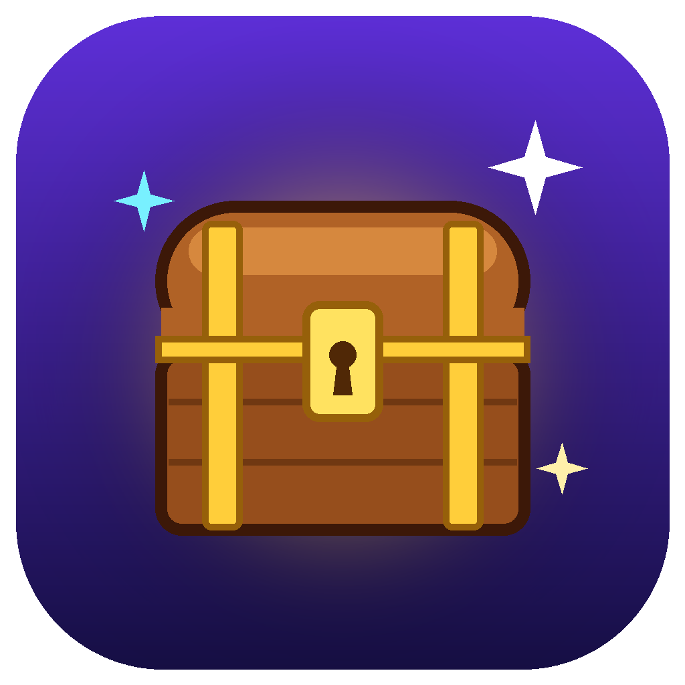
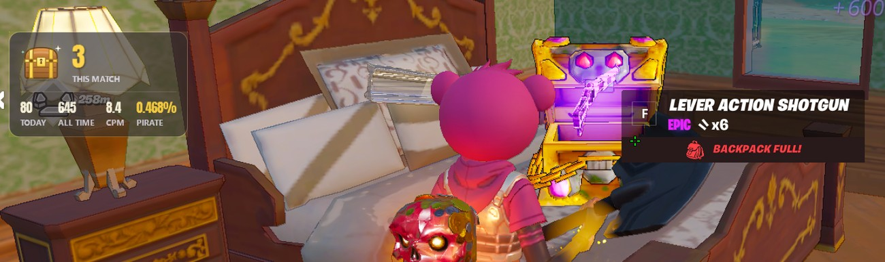
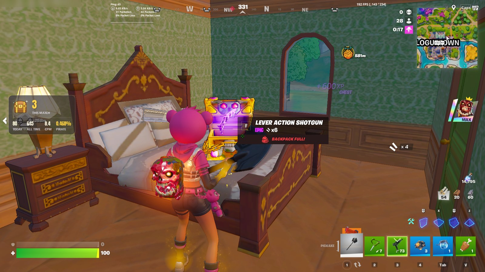
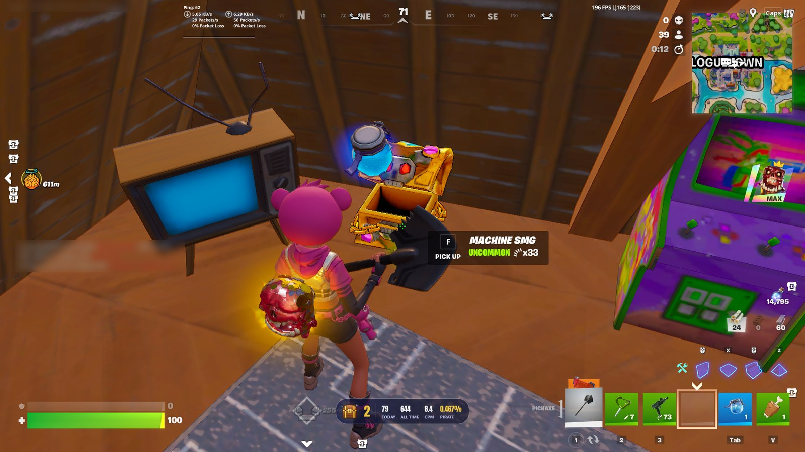
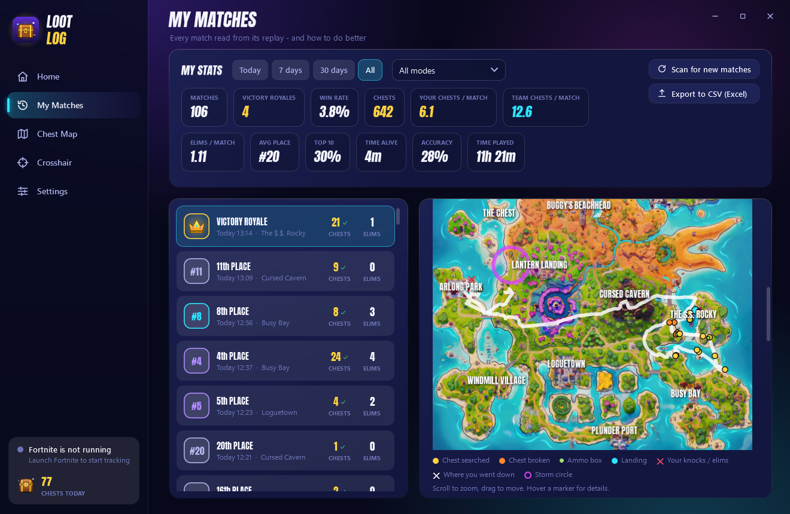
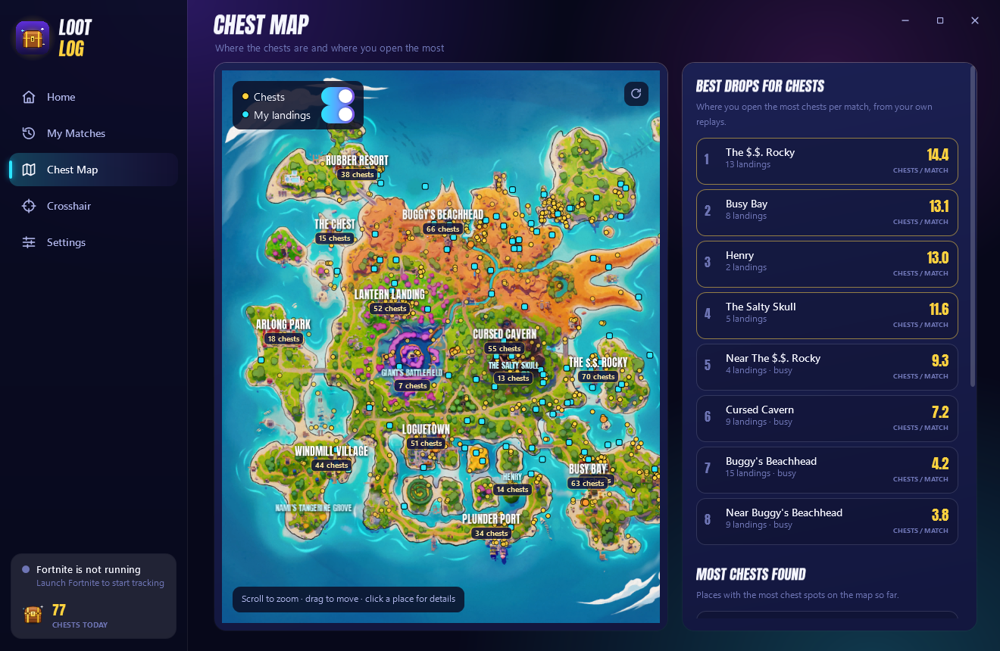
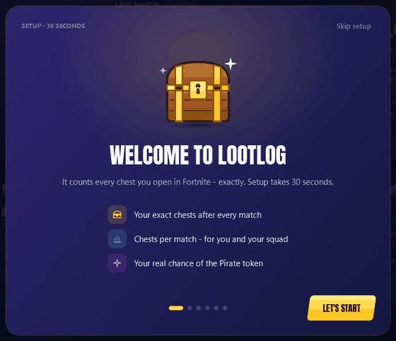

<p align="center">
  
</p>

<h1 align="center">LootLog</h1>

<p align="center">
  <b>Counts every chest you open in Fortnite, exactly, and shows your real Pirate token odds.</b><br>
  Free · No account · Collects nothing · Open source
</p>

<p align="center">
  <a href="https://github.com/moyutry/LootLog/releases/latest/download/LootLog-win-Setup.exe"></a>
</p>

<p align="center">
  <a href="https://github.com/moyutry/LootLog/releases/latest"></a>
  <a href="https://github.com/moyutry/LootLog/releases"></a>
  <a href="LICENSE"></a>
  
</p>

<p align="center">
  
  <br><sub>A real match: the box counts the chest you just opened, plus today, all time, chests per match and your Pirate odds.</sub>
</p>

## What you get

- 🎯 **The exact number.** After every match LootLog reads the replay Fortnite saves. It counts every chest you opened, including the ones you broke with the pickaxe. Ammo boxes are left out.
- 👥 **You and your squad.** Your chests, your team's chests, and chests per match (CPM) for both.
- 🏴‍☠️ **Pirate token odds.** Your real chance so far, at Epic's rate of 1 in 137,500 per chest. Treasure Hour chests count 1.5×.
- 📺 **A box in the game.** It shows your chests while you play. Streamers can let viewers see it.
- 🗺️ **Chest map and match reports.** Where you open the most chests, your route on the map, and tips for the next match.

## Screenshots

<table>
  <tr>
    <td width="50%"><br><sub><b>In the game:</b> box style</sub></td>
    <td width="50%"><br><sub><b>In the game:</b> bar style</sub></td>
  </tr>
  <tr>
    <td><br><sub><b>Home:</b> you vs your team, your odds, the next Treasure Hour</sub></td>
    <td><br><sub><b>Match report:</b> your route, every chest and fight</sub></td>
  </tr>
  <tr>
    <td><br><sub><b>Chest map:</b> the drops where you open the most chests</sub></td>
    <td><br><sub><b>Setup:</b> one simple step at a time, about 30 seconds</sub></td>
  </tr>
</table>

## Install (1 minute)

1. **[Download LootLog-win-Setup.exe](https://github.com/moyutry/LootLog/releases/latest/download/LootLog-win-Setup.exe)** and run it. No admin rights needed.
2. Windows may show *"Windows protected your PC"*. Click **More info → Run anyway**. ([Why?](#why-does-windows-warn-me))
3. Follow the short setup, then play. Your chests show up when you're back in the lobby.

LootLog **updates itself**, only when Fortnite is closed and never during a match. To remove it, go to **Windows Settings → Apps → LootLog → Uninstall**.

## 🔒 Safe and private

You don't have to trust me. Everything below can be checked in this repository.

| | |
|---|---|
| **Collects nothing about you** | No account, no login, no analytics, no ads, no tracking. Your stats stay in one folder on your PC (`%APPDATA%\FortniteHelper`). |
| **Only 2 internet connections, both downloads only** | `fortnite-api.com` for the island map picture ([code](src/FortniteHelper/Services/FortniteApi.cs)) and `github.com` to check for updates ([code](src/FortniteHelper/Services/UpdateService.cs)). Nothing is ever uploaded. Search the code for `http` and you will find only these. |
| **Never touches Fortnite** | It doesn't read or change the game's memory, doesn't inject anything, and doesn't modify game files. It only reads the log and replay files Fortnite saves itself, after the match ([replay code](src/FortniteHelper.ReplayReader/ReplayAnalyzer.cs)). |
| **Keys: only listens** | Windows tells it when you press a key, the same way OBS or Discord hotkeys work. It reacts only to your chest key. Keys are never blocked, saved or sent anywhere ([code](src/FortniteHelper/Services/RawInputService.cs)). |
| **Screen: one small spot, on your PC** | Right after you press the chest key, it reads the small "Search" prompt at your crosshair with Windows' own offline text reader. Images are never saved or sent; it only keeps a few colour numbers to learn what chests look like ([code](src/FortniteHelper/Services/ChestDetector.cs)). |
| **The overlay is a normal window** | It's a click-through window on top of the game, like the Discord or Steam overlay. |
| **100% open source** | Every line is in this repository under [GPL-3.0](LICENSE). Anyone can read it, build it and check it. |

**Check the download yourself:**
- Upload the file to [VirusTotal](https://www.virustotal.com/gui/home/upload) to scan it with 70+ antivirus engines.
- Compare its SHA-256 (run `Get-FileHash LootLog-win-Setup.exe` in PowerShell) with the one listed in the [release notes](https://github.com/moyutry/LootLog/releases/latest).

### Why does Windows warn me?

Windows SmartScreen warns about every new app that isn't signed with a paid certificate, even a safe one. LootLog isn't signed yet. The warning goes away as more people download it.

## FAQ

**Why can the number during the match differ from the final one?** During the match LootLog counts a chest when you press your chest key and the "Search" prompt disappears. Fortnite shows the same prompt for ammo boxes, and broken chests show none. So the live number is an estimate that gets better every match. The number after the match comes from the replay and is exact.

**No number after a match?** Turn on **Fortnite → Settings → Game → Replays → Record Replays**.

**The box doesn't show in the game?** Set **Fortnite → Settings → Display → Window Mode → Windowed Fullscreen**.

**Can my stream viewers see the box?** Yes, if you want. Turn on "I stream or record" in the setup, or in Settings turn off "Hide my overlays from recordings".

**Is this from Epic?** No. LootLog is a fan-made tool and is not affiliated with or endorsed by Epic Games. Fortnite is a trademark of Epic Games, Inc.

---

<details>
<summary><b>For developers</b></summary>

C# / WPF on .NET 10. The installer and updates use [Velopack](https://velopack.io).

```powershell
powershell -ExecutionPolicy Bypass -File install.ps1             # build, pack the installer, install here
powershell -ExecutionPolicy Bypass -File install.ps1 -NoInstall  # build + pack only (dist\releases)
powershell -ExecutionPolicy Bypass -File install.ps1 -Publish    # ...and upload to GitHub Releases (feeds auto-update)
dotnet test tests/FortniteHelper.Tests
```

```
src/FortniteHelper.Core          Log parser, match tracker, chest prompt classifier, chest-vs-ammo colour model, Pirate odds
src/FortniteHelper.ReplayReader  Replay analysis: who opened which container, squad breakdown, route, fights, storm
src/FortniteHelper               The app (WPF): pages, overlays, screen capture, OCR, raw input, tray, updates
tests/                           xUnit tests
```

Local data in `%APPDATA%\FortniteHelper`: `settings.json`, `matches.json`, `analysis\` (one file per replay), `chestmap.json`, `detector.json` (colour numbers the live counter learned, no images), `app.log`.

`LootLog.exe --snap <folder>` renders every page to PNGs without overlays or input hooks.

</details>

## License

[GPL-3.0](LICENSE). Built with [FortniteReplayReader](https://github.com/Shiqan/FortniteReplayDecompressor) (MIT), [Velopack](https://velopack.io) (MIT), [Vortice.Windows](https://github.com/amerkoleci/Vortice.Windows) (MIT) and the [Anton](https://fonts.google.com/specimen/Anton) font (OFL). Island map from [fortnite-api.com](https://fortnite-api.com).
